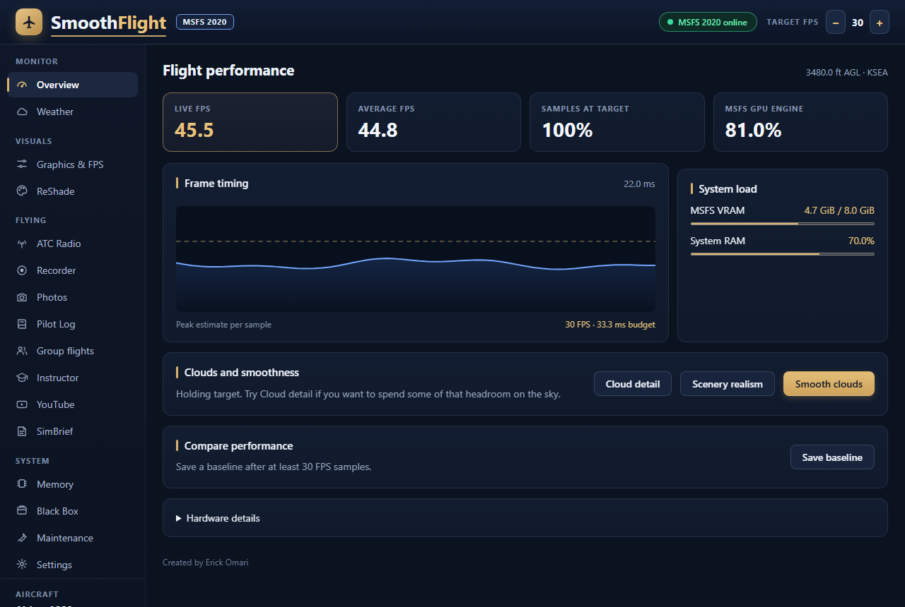
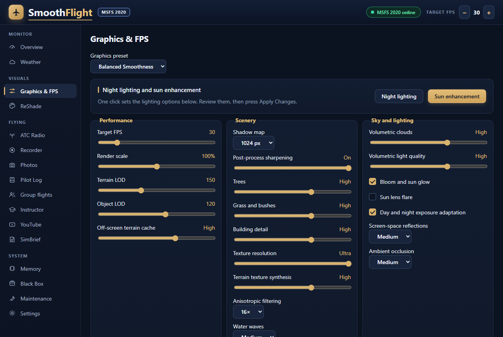
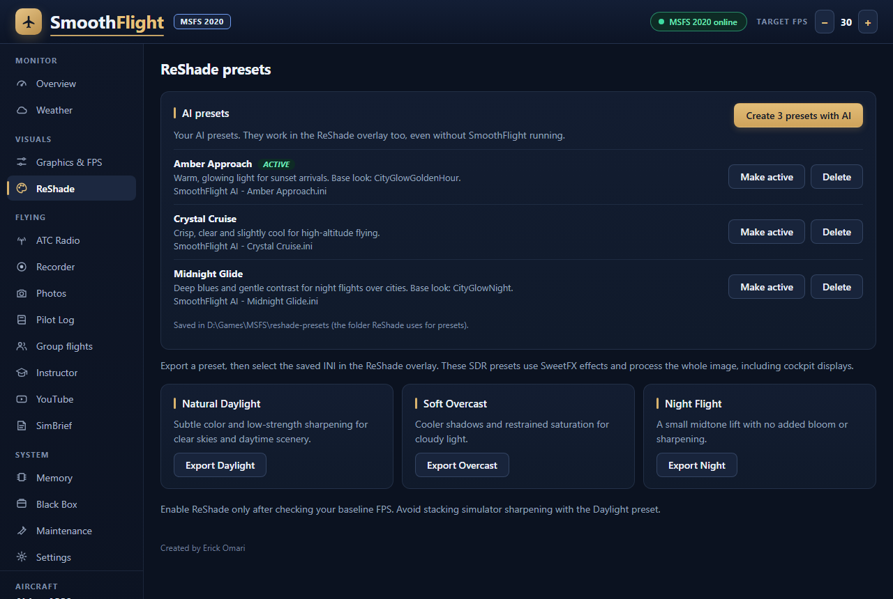
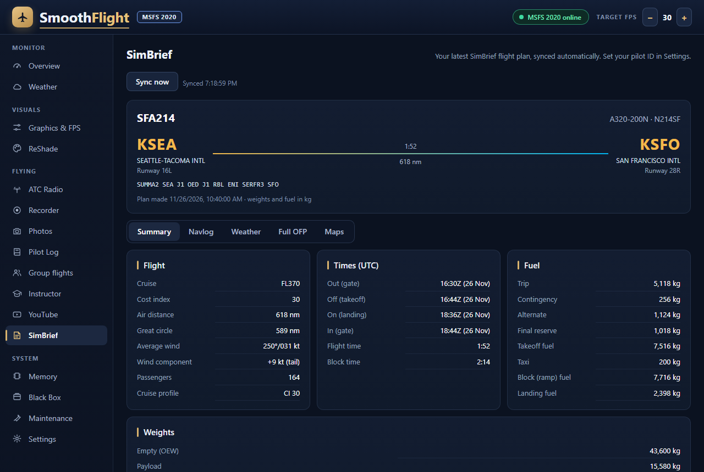
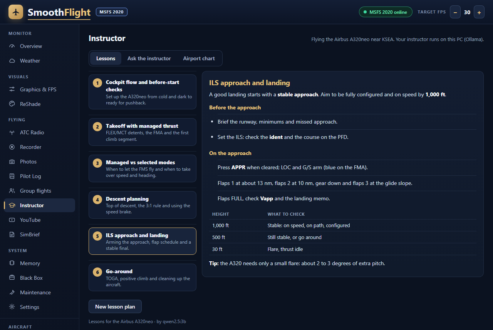
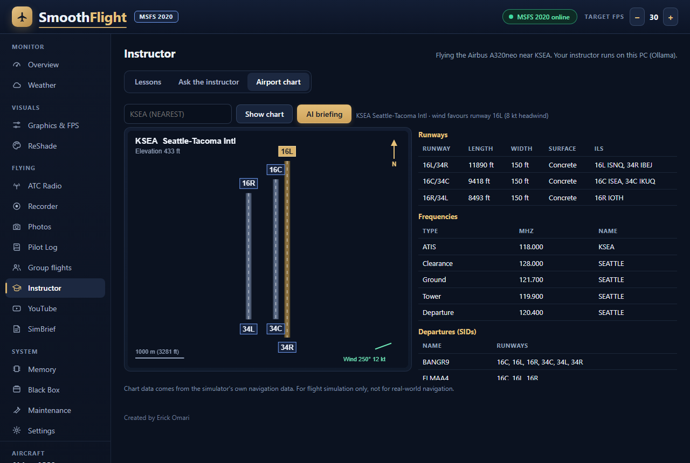
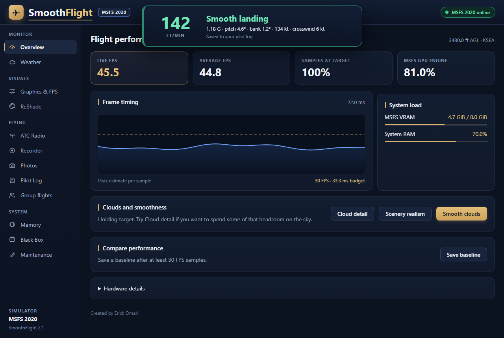
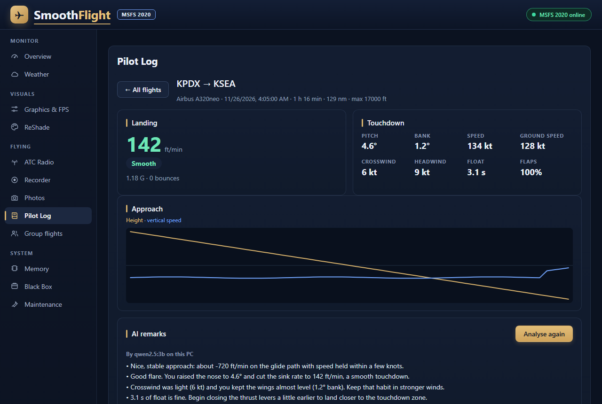
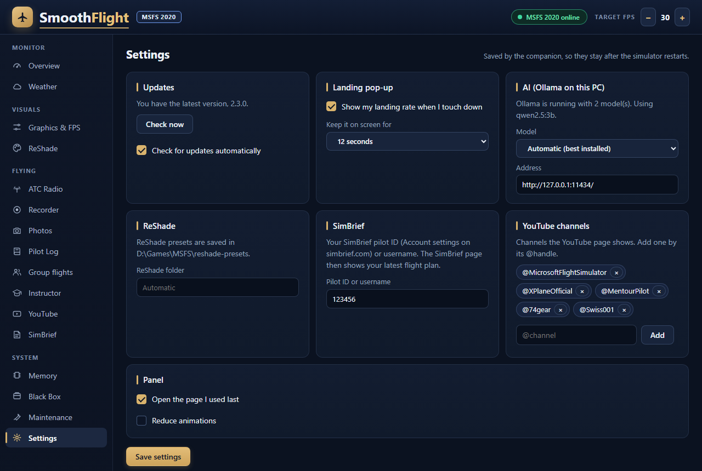

  

<h1 align="center">SmoothFlight</h1>

  <b>Smoother flights, better looks and a co-pilot toolkit for X-Plane 12 and Microsoft Flight Simulator 2020 / 2024.</b> 
  In-sim dashboards, AI instructor and charts, SimBrief, ReShade looks, package launchers and a memory guard.

  <a href="https://github.com/pitchiluxe/smoothflight/releases/latest"><b>⬇ Download the latest version</b></a> ·
  <a href="https://pitchiluxe.github.io/smoothflight/">Website</a> ·
  <a href="#install">Install</a> ·
  <a href="#features">Features</a> ·
  <a href="#troubleshooting">Troubleshooting</a>

  
  
  
  

---

## What is SmoothFlight?

SmoothFlight puts a full flight-sim toolkit **inside the simulator**: open it from the MSFS toolbar or from X-Plane's Plugins menu and you get live performance, graphics tuning, weather, an AI flight instructor with airport charts, your SimBrief flight plan, a pilot log with landing analysis and more, without alt-tabbing out of your flight.

It also comes with a **Package Launcher** that turns Community packages and scenery on or off by region, frees memory before the sim starts, and launches the simulator (directly or through Map Enhancement).

The **Instructor**, **SimBrief**, **YouTube** and **Settings** pages are in both the MSFS panel and the X-Plane window.

Everything runs **on your PC**. There is no account to create, and the AI features use a local model (Ollama), so your flights are never uploaded.

## Features

### Monitor your flight
| | |
|---|---|
|  | **Overview**: live FPS, frame-time graph, CPU, GPU and memory, with a target-FPS meter and a saved baseline to compare against.  **Weather**: wind, visibility, temperature, pressure, precipitation and cloud layers around your aircraft.  **Black Box**: records low-FPS moments, frame-time spikes, high VRAM and connection problems with the position and weather at the time, exportable as a report. |

### Look better, fly smoother
| | |
|---|---|
|  | **Graphics & FPS**: ready-made profiles (scenery realism, cloud detail, smooth clouds) plus individual controls for render scale, LOD, trees, grass, buildings, clouds, shadows and more. Every change is backed up first.  **Memory guard**: frees RAM from idle background apps when memory runs low (never during a flight, never sim add-ons), and closes apps you pick. |
|  | **ReShade looks**: Natural Daylight, Soft Overcast and Night Flight presets.  **AI presets**: one click and the AI designs three named looks (for example "Amber Approach" or "Midnight Glide") and saves them next to your other ReShade presets. **Activate** switches the look instantly while you fly. |

### Your co-pilot
| | |
|---|---|
|  | **SimBrief**: enter your SimBrief pilot ID once in Settings and your latest flight plan appears in the sim: route, times, fuel, weights, METAR/TAF for departure, arrival and alternates, the navlog, route maps and the full OFP. It syncs automatically. |
|  | **AI Instructor**: lessons written for the aircraft you are flying, and a chat with an instructor who knows your altitude, airport and wind. Answers are nicely formatted with headings, lists and tables. |
|  | **Airport charts**: runways, ILS, frequencies, SIDs, STARs and approaches drawn from the simulator's own navigation data, the wind-favoured runway highlighted, and an AI briefing. Charts and the instructor can each open in their own movable toolbar panel. |

### Your flights, remembered
| | |
|---|---|
|  | **Landing rate**: an animated pop-up the moment you touch down, with your rate of descent, G-force and a grade from *Butter* to *Hard*. |
|  | **Pilot log**: every flight logged automatically (aircraft, airports, times, highest altitude, landing). Open a flight to see the approach profile, touchdown details and AI remarks on what went well and what to improve. |

### And more
- **YouTube**: the latest videos from flight-sim channels (you choose the channels), played in a small window you can move anywhere while you cruise.
- **ATC Radio**: follows the nearest airport; one click to listen on LiveATC.
- **Recorder and Photos**: record a flight and replay it on a map; take and caption screenshots.
- **Group flights**: see friends on a live map in a private room with an invite code.
- **Settings and updates**: landing pop-up, AI model, ReShade folder, SimBrief ID, YouTube channels, and an in-sim **Check for updates** button.

## Install

1. **Download** the zip for your simulator from the [latest release](https://github.com/pitchiluxe/smoothflight/releases/latest):
   - `SmoothFlight-MSFS-x.y.z.zip` for **MSFS 2020 and/or 2024** (Microsoft Store, Game Pass or Steam)
   - `SmoothFlight-XPlane12-x.y.z.zip` for **X-Plane 12**
2. **Close the simulator**, unzip, and double-click the installer:
   - `Install-SmoothFlight-MSFS.exe`: finds MSFS 2020 and/or 2024 and installs the toolbar panel into each one.
   - `Install-SmoothFlight-XPlane.exe`: asks for your X-Plane 12 folder if it can't find it.
   - If Windows SmartScreen appears, choose **More info → Run anyway**.
3. **Start flying**:
   - **MSFS**: start *SmoothFlight Companion* and the *MSFS Package Launcher* from the desktop, then open **SmoothFlight** from the in-sim toolbar.
   - **X-Plane**: start X-Plane from the *X-Plane 12 Package Launcher* shortcut, then open **Plugins → SmoothFlight**.

### Requirements
- Windows 10 or 11 (64-bit)
- Microsoft Flight Simulator 2020 / 2024, and/or X-Plane 12
- Optional:
  - [Ollama](https://ollama.com) with a small model such as `llama3.2` or `qwen2.5` for the AI Instructor, AI briefings, pilot-log remarks and AI ReShade presets
  - [ReShade](https://reshade.me) for the ReShade looks
  - A free [SimBrief](https://www.simbrief.com) account for the SimBrief page
  - Microsoft Edge (included with Windows) for the YouTube window

## Updates

SmoothFlight checks for new versions by itself. When one is out, the launcher (and the **Settings** page in the sim) offers **Update**: it downloads the new version, verifies its checksum and installs it. Your settings, pilot log and pairing are kept.

## Using the AI features

The AI runs locally through **Ollama**: install it, then run `ollama pull qwen2.5:3b` (or `llama3.2`) once. SmoothFlight finds it automatically. Pick a different model under **Settings → AI**. Nothing is sent to the internet.

## Privacy

- No account, no telemetry, no ads.
- Flight data, the pilot log and settings stay in `%LOCALAPPDATA%\SmoothFlight` on your PC.
- The only internet requests are: checking this page for updates, your SimBrief plan (when you set a pilot ID), YouTube feeds and thumbnails (when you open the YouTube page), and group-flight positions (only after you join a group).

## Troubleshooting

<b>The SmoothFlight panel says "offline" or keeps reconnecting</b>

Make sure *SmoothFlight Companion* is running (its icon is in the notification area). Start it before the simulator, or restart it from the desktop shortcut.

<b>MSFS Map Enhancement shows "MITM test failed"</b>

Some Windows installs use the BBR2 TCP setting, which breaks local connections that Map Enhancement relies on. The MSFS Package Launcher detects this and offers to fix it with one administrator prompt (it switches Windows back to the standard CUBIC setting).

<b>AI features say Ollama is not running</b>

Install Ollama from <a href="https://ollama.com">ollama.com</a>, run <code>ollama pull qwen2.5:3b</code>, and check <b>Settings → AI</b>. The address should be <code>http://127.0.0.1:11434/</code>.

<b>An AI ReShade preset doesn't change the look right away</b>

After installing or updating SmoothFlight, restart the simulator once so ReShade loads SmoothFlight's preset shortcuts. After that, <b>Activate</b> in the in-sim panel switches the look instantly.

<b>The YouTube window doesn't show over the simulator</b>

Run MSFS in windowed or borderless full-screen mode, or use <b>Play on this PC</b> to watch in your browser (handy on a second monitor).

## About

SmoothFlight is free to use. Its source code is not public.

Created by **Erick Omari**. All rights reserved.
